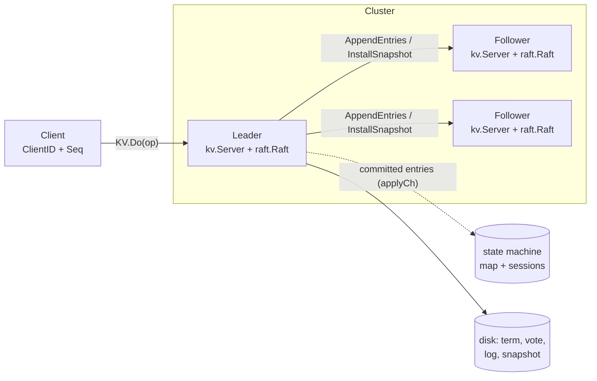

# Quorum

[](https://github.com/just-manthan/quorum/actions/workflows/ci.yml)


**A fault-tolerant, linearizable key/value store built on Raft. I wrote the consensus layer, the network simulator, and a linearizability checker from scratch in Go, with no external dependencies.**

Run five replicas. Cut the network into pieces, drop and reorder messages, crash nodes mid-write. Every acknowledged write survives, and an automated checker shows that every history the clients observed is *linearizable*: it looks exactly as if one machine had executed the operations one at a time, in real-time order.

```
$ go test ./kv -run EverythingAtOnce -v
=== RUN   TestLinearizableEverythingAtOnce
    kv_test.go:380: 277 operations checked: linearizable
--- PASS: TestLinearizableEverythingAtOnce (8.50s)
```

---

## Features

| Layer | What it does |
|---|---|
| **Raft consensus** (`raft/`) | Leader election with randomized timeouts. Log replication with *fast log backtracking*: the leader skips a whole conflicting term per round trip instead of one entry. Durable state. Log compaction with snapshots and `InstallSnapshot`. |
| **Replicated KV store** (`kv/`) | `Get` / `Put` / `Append` / `Delete` / `CompareAndSwap`. All operations, reads included, go through the log, so every operation is linearizable. Client sessions make retries **exactly-once**. |
| **Network simulator** (`simnet/`) | An in-process network that can drop requests or replies, delay and reorder messages, partition nodes, and crash servers. It gob-encodes every message, so nodes never share memory. |
| **Linearizability checker** (`linearizability/`) | Wing & Gong backtracking search with memoization. It checks each key separately, because linearizability is compositional, and runs on every chaos test. |
| **Real deployment** (`cmd/quorum`, `transport/`) | TCP transport (`net/rpc`) with timeouts and reconnects. Crash-safe file persistence (write temp file, fsync, atomic rename). HTTP API. |

## Architecture



**How a write flows:**

1. The client sends `Op{Put, k, v, ClientID, Seq}` to the replica it thinks is the leader. If that replica is not the leader, the client moves on to the next one.
2. The leader appends the op to its log with `raft.Start`, persists it, and replicates it to the followers.
3. When a majority stores the entry, the leader commits it. Every replica's applier then delivers it, in log order, to its state machine.
4. The state machine applies the op, unless it has already applied `(ClientID, Seq)`. The waiting RPC handler then replies.

## Quick start

```bash
git clone https://github.com/just-manthan/quorum && cd quorum
./scripts/demo.sh            # 3-node cluster on localhost: write, kill the leader, keep going
```

Here is the demo output (abridged):

```
== writing through node 0
greeting = hello   (read via node 1)
seq      = 1,2,3,  (read via node 2)
== leader is node 1 — killing it
== new leader is node 2
seq      = 1,2,3,4,  (no acknowledged write was lost)
== distributed lock via compare-and-swap
{ "swapped": true,  "value": "" }
{ "swapped": false, "value": "alice" }
== restarting node 1; it catches up from the log/snapshot
seq on restarted node = 1,2,3,4,
```

To run nodes yourself:

```bash
go build -o bin/quorum ./cmd/quorum
PEERS=127.0.0.1:7000,127.0.0.1:7001,127.0.0.1:7002
./bin/quorum -id 0 -peers $PEERS -http :8000 &
./bin/quorum -id 1 -peers $PEERS -http :8001 &
./bin/quorum -id 2 -peers $PEERS -http :8002 &

curl -X PUT --data 'world' localhost:8000/kv/hello
curl localhost:8002/kv/hello                       # -> world (any node works)
curl -X POST -d '{"expect":"","value":"me"}' localhost:8001/kv/lock/cas
curl localhost:8000/status                          # term, role, commit index, ...
```

## How it's tested

A distributed system is only as good as its failure testing. The suite runs under `go test -race` in CI.

**Raft safety under adversarial schedules** (`raft/raft_test.go`). The harness checks the core safety property every time any peer applies an entry: no two peers ever apply different commands at the same log index. The scenarios include:

- re-election after partitions, and no leader without a quorum
- a stale leader rejoining with conflicting, uncommitted entries
- *Figure 8* from the Raft paper, under constant leader crashes and on an unreliable, reordering network
- fast backup, where a follower is ~100 entries divergent across several terms
- snapshots installed on followers that fell behind, and crash and restart from snapshot

**End-to-end linearizability** (`kv/kv_test.go`). 5–7 concurrent clients issue random `Get`/`Put`/`Append`/`CAS` operations while a *nemesis* goroutine partitions the cluster, crashes and restarts replicas, and drops messages. Every call and return is timestamped, and the checker then proves that the whole history is linearizable.

**The checker itself is tested**. Known linearizable and non-linearizable histories are in `linearizability/checker_test.go`. As a mutation test, I removed the server's duplicate detection. The chaos test failed right away and printed the offending history (a retried `Append` applied twice).

**A real TCP cluster** (`transport/tcp_test.go`). Three nodes run over loopback sockets with on-disk persistence. The test kills the leader and verifies that no data is lost.

```bash
go test ./...            # everything
go test -race ./...      # with the race detector (what CI runs)
go test ./kv -run Linearizable -v
```

## Design decisions worth talking about

- **Reads go through the log.** This is the simplest way to make reads linearizable: a leader that was deposed but doesn't know it yet can't serve a stale read. The cost is a round of replication for each read. The next step would be *ReadIndex* or leader leases (§6.4 of the Raft thesis).
- **Heartbeats are separate from replication.** Each follower has a long-lived replicator goroutine that keeps at most one batch in flight, so every entry goes over the wire about once (`TestRPCBytes` checks this). Heartbeats are sent fire-and-forget, independent of the replicators. An earlier version sent heartbeats through the replicator. With reordered replies a heartbeat could get stuck behind a 2-second-slow RPC, and followers would start needless elections. The race-detector run of the Figure 8 test caught it.
- **Commit only entries from the current term** (§5.4.2). Counting replicas of an old-term entry is unsafe. *Figure 8* in the paper shows how such an entry can be overwritten after it reaches a majority.
- **Exactly-once semantics.** Each client tags its requests with `(ClientID, Seq)`. The state machine remembers the last `Seq` applied per client and the reply it gave. These sessions are part of the snapshot, so dedup survives crashes.
- **Crash-safe storage.** `FilePersister` writes the state and the snapshot as one file through *temp file → fsync → rename → fsync dir*. A crash during a save leaves the old version or the new one, never a mix of the two. A peer that has been killed stops writing to storage.
- **One protocol, two transports.** Handlers use the `net/rpc` signature, so the same code runs on `simnet` in tests and on TCP in production.

## Project layout

```
raft/              consensus: election, replication, persistence, snapshots
kv/                replicated key/value state machine + client library
simnet/            simulated unreliable network for tests
linearizability/   history checker
transport/         TCP transport (net/rpc) + integration test
cmd/quorum/        node binary with HTTP API
scripts/demo.sh    local 3-node demo
```

## What I'd build next

- Membership changes (joint consensus) to add or remove nodes without downtime
- ReadIndex / lease-based reads, so reads don't need a log write
- Sharding: many Raft groups behind a shard controller, with shard migration
- Pipelined AppendEntries and batching under high load
- Pre-vote, so a node that rejoins after a partition can't disrupt the cluster

## References

- D. Ongaro and J. Ousterhout. [In Search of an Understandable Consensus Algorithm](https://raft.github.io/raft.pdf). USENIX ATC 2014.
- D. Ongaro. [Consensus: Bridging Theory and Practice](https://github.com/ongardie/dissertation). PhD thesis, 2014.
- M. Herlihy and J. Wing. *Linearizability: A Correctness Condition for Concurrent Objects*. TOPLAS 1990.
- J. Wing and C. Gong. *Testing and Verifying Concurrent Objects*. JPDC 1993.

## License

MIT © Manthan Desai
